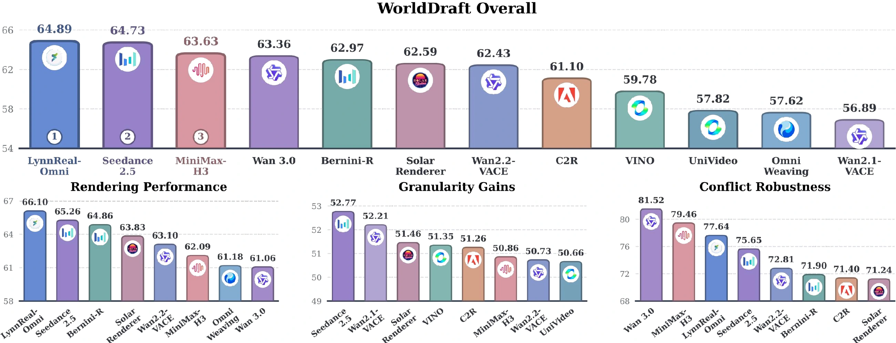
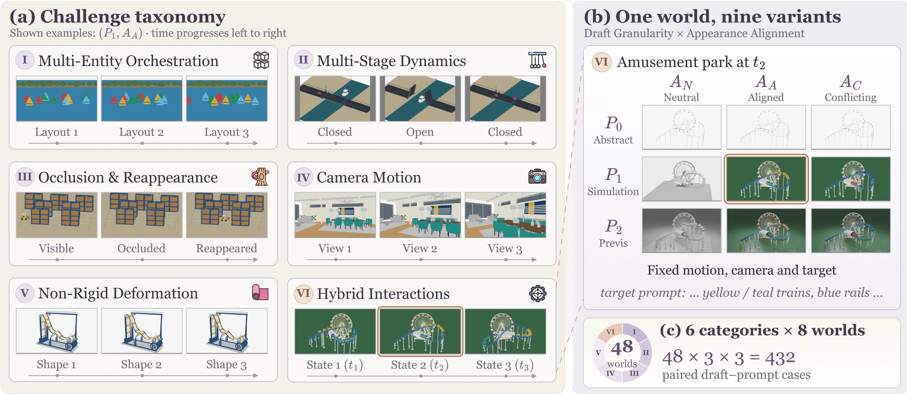

<div align="center">


## If Code Builds the World, Can Video Models Just Render It?

Zhiyu Hou<sup>\*</sup>, Wen-Jie Shu<sup>\*</sup>, Harold H. Chen<sup>\*,†</sup>, Weilin Ruan, Chenfei Liao,<br>
Liuzhou Zhang, Disen Lan, Xiaogang Xu, Qi Chen, Ser-Nam Lim

SUSTech &nbsp; ZODA &nbsp; HKUST &nbsp; CUHK &nbsp; HKUST(GZ) &nbsp; FDU &nbsp; ZJU &nbsp; UCF

<sup>\*</sup> Equal Contribution &nbsp; <sup>†</sup> Project Lead

<!-- Replace the Paper href (#) with the arXiv URL when available. -->
[Paper](#) &nbsp; | &nbsp; [Project Page](https://haroldchen19.github.io/WorldDraft-site/) &nbsp; | &nbsp; [Dataset](https://huggingface.co/datasets/KevinHuge/WorldDraft) &nbsp; | &nbsp; [BibTeX](#citation) &nbsp; | &nbsp; [License](LICENSE)

</div>

<p align="center"></p>

## 📌 News

- **11/2026:** Benchmark data and evaluation code released.

## 🌟 Overview

**WorldDraft benchmarks video models as generative renderers:** executable 4D world → draft video → photorealistic video. It tests whether models preserve the draft's geometry, motion, events, and camera while realizing the target appearance specified in text.

<p align="center"></p>

- **48 worlds, six challenges:** multi-entity orchestration (A), multi-stage dynamics (B), occlusion and reappearance (C), camera motion (D), non-rigid deformation (E), and hybrid interactions (F).
- **432 paired cases:** a 3 × 3 design crosses draft granularity (abstract, simulation, previs) with appearance alignment (neutral, aligned, conflicting), holding dynamics and the target prompt fixed.
- **12 video models:** world preservation and visual realization are evaluated through Rendering Performance, Granularity Gains, and Conflict Robustness.

See the [project page](https://haroldchen19.github.io/WorldDraft-site/) for the leaderboard and video comparisons.

## 📊 Benchmark

| Metric group | Metrics |
|---|---|
| Entity & spatial | Global / Local Count, BBox IoU |
| Motion & event | Matched Track Coverage, Interaction Success Rate (ISR), Event Timing Coverage |
| Camera | Rotation error, translation error, CamMC (D series) |
| Render fidelity | Attribute QA (RF), image quality, aesthetic quality, CLIP alignment |
| Appearance persistence | Target attribute persistence (AP) |
| Disentanglement | Source color leakage under conflicting appearance (SL) |

Ground truth is exported from Blender: visible-instance masks, entity boxes, event boundaries, and camera trajectories. See the [metric protocol](eval/docs/metrics.md) for definitions, sampling, and aggregation.

## 🚀 Getting started

```bash
git clone https://github.com/KevinHuge/WorldDraft.git
cd WorldDraft
```

Follow the [evaluation guide](eval/USAGE.md#1-environments) to set up environments and model weights, then download drafts and ground truth. Add `--with-scenes` to include the Blender scenes.

```bash
bash eval/download_data.sh
```

1. Generate videos from `data/drafts/<case>/<case>_<cell>/<case>_<cell>.mp4` with `data/drafts/<case>/target_prompt.txt`. Save each result as `<videos>/<model>/<case>/<cell>/output.mp4`.
2. Register how your model receives the draft in [`eval/configs/models.yaml`](eval/configs/models.yaml).
3. Run all evaluation stages and build the report:

   ```bash
   bash eval/eval.sh --videos <videos> --models <model> --out eval/results/<model>
   ```

Per-stage commands and output formats are documented in [eval/USAGE.md](eval/USAGE.md).

## 📁 Repository

| Path | Contents |
|---|---|
| [eval/](eval/README.md) | Evaluation package, protocols, configs, and requirements |
| [data/](data/README.md) | Benchmark data downloaded from Hugging Face; large files are not tracked |
| [Data guide](eval/docs/data.md) | File formats and ground-truth generation |

## 📝 Citation

If you find WorldDraft useful, please cite:

```bibtex
@misc{hou2026worlddraft,
  title={WorldDraft: If Code Builds the World, Can Video Models Just Render It?},
  author={Hou, Zhiyu and Shu, Wen-Jie and Chen, Harold H. and Ruan, Weilin and Liao, Chenfei and Zhang, Liuzhou and Lan, Disen and Xu, Xiaogang and Chen, Qi and Lim, Ser-Nam},
  year={2026},
  howpublished={arXiv preprint},
  url={https://haroldchen19.github.io/WorldDraft-site/}
}
```
